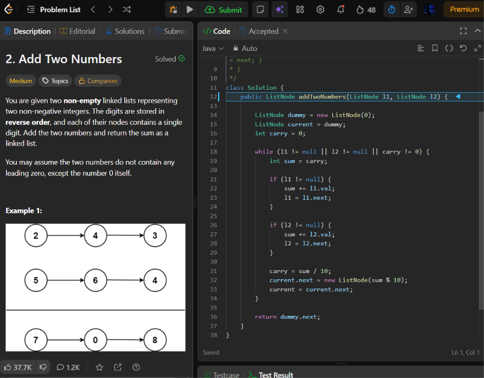
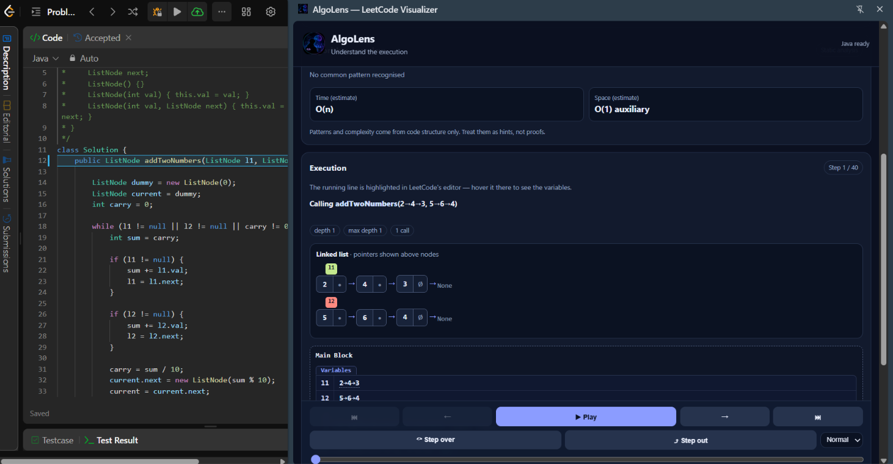
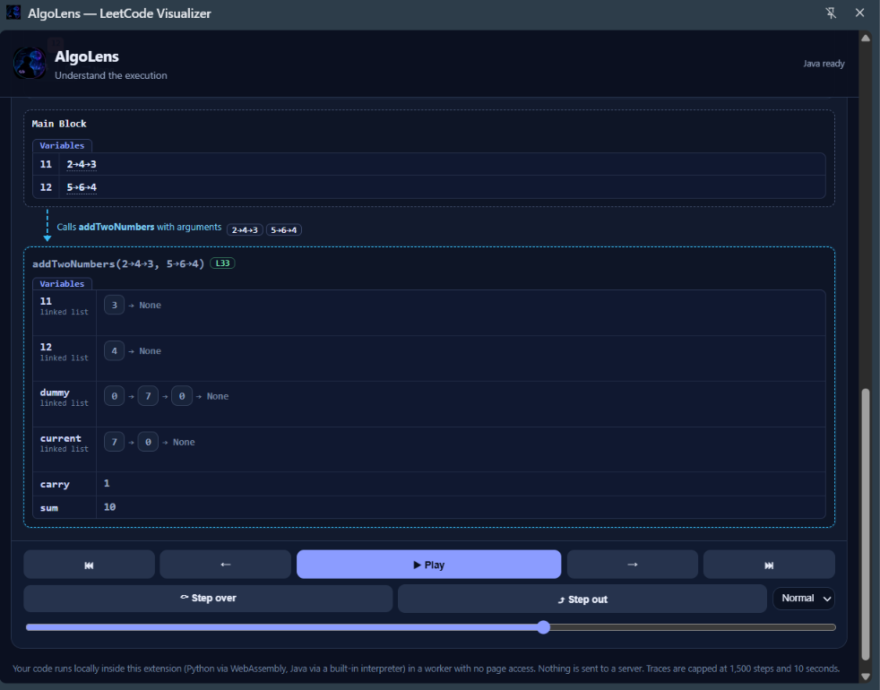

# ⚡ AlgoLens — See Your Code Think.

<p align="center">
  
</p>

<p align="center">
  <strong>Stop guessing what your algorithm does. Watch it happen.</strong>
  <br />
  An interactive learning experience that brings your LeetCode solutions to life, one execution step at a time.
</p>

<p align="center">
  <a href="https://github.com/Garv3068/AlgoLens/stargazers"></a>
  <a href="https://github.com/Garv3068/AlgoLens/network/members"></a>
  <a href="https://github.com/Garv3068/AlgoLens/issues"></a>
  <a href="https://github.com/Garv3068/AlgoLens"></a>
</p>

---

## 🧠 The Idea Behind AlgoLens

Ever solved a LeetCode problem, passed every test case, and still wondered **why your code actually worked?**

You understand the logic. You've written the loops. You know what a stack does.

But when recursion kicks in, pointers move, or a dynamic programming table starts filling up, keeping track of everything in your head becomes a challenge.

**AlgoLens is built to bridge that gap.**

AlgoLens is a developer-focused Chrome extension designed to help you understand algorithms by visualizing their execution alongside your code. Instead of relying solely on static explanations or memorized patterns, you can explore how your program evolves step by step.

> **Your code. Your execution. Your understanding.**

## ✨ What Makes AlgoLens Different?

### 🔍 Follow the Execution

See which line is executing and connect it to the changes happening inside your program.

### 📦 Watch Data Structures Evolve

Go beyond reading variable names. Visualize arrays, stacks, pointers, and other structures as your algorithm progresses.

### 🌳 Make Recursion Visible

Explore recursive calls and call-stack changes to better understand how problems break down and come back together.

### ⏪ Learn at Your Own Pace

Step through an execution, inspect intermediate states, and move backward to revisit earlier decisions.

### 🧩 Designed to Be Extensible

Build toward reusable visualization components that can adapt to different algorithms instead of relying on a separate hardcoded animation for every problem.

### 💻 Built Around Real Code

The goal is to connect visual explanations to the execution of the code being analyzed, making debugging and learning part of the same experience.

---

## 🎬 See It in Action

### 01 — Code Meets Visualization

Understand the relationship between your source code and the state of your algorithm.

<p align="center">
  
</p>

### 02 — Data Structures, Made Visible

See how values and structures change as execution advances.

<p align="center">
  
</p>

### 03 — Recursion Without the Confusion

Follow recursive calls and understand how an algorithm moves through its execution.

<p align="center">
  
</p>

---

## ⚙️ How It Works

The intended workflow is simple:

```text
   LeetCode Problem
          │
          ▼
   Your Source Code
          │
          ▼
   AlgoLens Analysis
          │
          ▼
   Execution Trace
          │
          ├───────────────┐
          ▼               ▼
  Current Code Line   Program State
                          │
               ┌──────────┼──────────┐
               ▼          ▼          ▼
             Arrays     Stacks     Pointers
                          │
                          ▼
                 Step-by-Step Learning
```

The goal is to keep code, execution state, and visual explanations synchronized so you can understand not just *what* happened, but *where* and *why* it happened.

---

## 🗺️ Project Roadmap

AlgoLens is being developed iteratively, with execution accuracy and reusable visualization components as key priorities.

- [ ] **Reliable execution tracing** — synchronize line highlighting, variable updates, call-stack changes, and backward stepping.
- [ ] **Python tracing improvements** — use actual trace events for execution-linked visualizations, including Merge Sort.
- [ ] **Reusable visualization engine** — create generic renderers for arrays, stacks, recursion trees, pointers, and graphs.
- [ ] **Language support** — build toward Python and Java support.
- [ ] **Interactive playback** — inspect execution steps and revisit previous program states.
- [ ] **Algorithm explanations** — connect code execution to clear, contextual explanations.
- [ ] **Polished Chrome side panel** — make the experience accessible alongside LeetCode.

*Roadmap items describe development goals; availability depends on the current implementation.*

---

## 🛠️ Built With

AlgoLens is being developed as a Chrome extension with a native side-panel experience.

| Technology | Purpose |
|---|---|
| Chrome Extensions API | Browser integration |
| Chrome Side Panel API | Dedicated visualization interface |
| Execution tracing | Capture and inspect program state |
| Reusable UI components | Render data structures and algorithm states |

*The exact implementation stack and setup commands may evolve as the project develops.*

---

## 🚀 Getting Started

### Prerequisites

- Google Chrome or a Chromium-based browser.
- Git.
- The development tools and dependencies specified by the project.

### Installation

**1. Clone the repository**

```bash
git clone https://github.com/Garv3068/AlgoLens.git
cd AlgoLens
```

**2. Install the project dependencies**

Follow the instructions for the package manager and dependencies defined in the repository.

**3. Load the extension in Chrome**

1. Open `chrome://extensions/`.
2. Enable **Developer mode**.
3. Select **Load unpacked**.
4. Choose the extension's directory containing its `manifest.json`.
5. Open a supported LeetCode problem and launch AlgoLens if the current build supports that workflow.

> If the extension or tracing pipeline is still under development, some features may not be available yet.

---

## 📁 Screenshots and Assets

All README screenshots are stored in the repository's `assets/` directory.

```text
AlgoLens/
├── assets/
│   ├── hero.png
│   ├── code-tracing.png
│   ├── data-structures.png
│   └── recursion-tree.png
├── README.md
└── ...
```

You can add more screenshots, GIFs, or short demonstrations to this folder as the project grows.

**Tip:** Use PNG for crisp interface screenshots and GIF or video demonstrations for features where movement is important.

---

## 🎯 Who Is AlgoLens For?

- **DSA learners** who want to build intuition instead of memorizing solutions.
- **LeetCode enthusiasts** who want to understand their code beyond the final answer.
- **Interview candidates** preparing for technical interviews.
- **Developers** debugging complex logic or exploring unfamiliar algorithms.
- **Educators and mentors** looking for a more interactive way to explain program execution.

---

## 💡 The Philosophy

Learning algorithms shouldn't mean mentally simulating dozens of operations and hoping you didn't miss one.

A good visualization makes invisible state visible. A good debugger helps you investigate. A good learning tool connects the two.

AlgoLens aims to bring these experiences together — helping you move from *"I think I understand this solution"* to *"I can explain exactly how it works."*

---

## 🤝 Contributing

Ideas, bug reports, feature requests, and contributions are welcome!

1. Fork the repository.
2. Create a feature branch:

   ```bash
   git checkout -b feature/your-feature
   ```

3. Make your changes and test them.
4. Commit your changes:

   ```bash
   git commit -m "feat: describe your changes"
   ```

5. Push your branch and open a pull request.

For larger changes, consider opening an issue first to discuss the proposal.

---

## 🐛 Feedback and Issues

Found a bug or have an idea that could make algorithm learning better?

- [Open an issue](https://github.com/Garv3068/AlgoLens/issues)
- [Explore the source code](https://github.com/Garv3068/AlgoLens)
- [Star the repository](https://github.com/Garv3068/AlgoLens/stargazers) if you like the idea.

---

## 👨‍💻 Creator

**Garv Goel**

Building AlgoLens to make algorithms easier to understand, one execution step at a time.

<p align="center">
  <a href="https://github.com/Garv3068">GitHub Profile</a>
  &nbsp; • &nbsp;
  <a href="https://github.com/Garv3068/AlgoLens">AlgoLens Repository</a>
</p>

---

<p align="center">
  <strong>Don't just read the algorithm. See it think. ⚡</strong>
</p>
