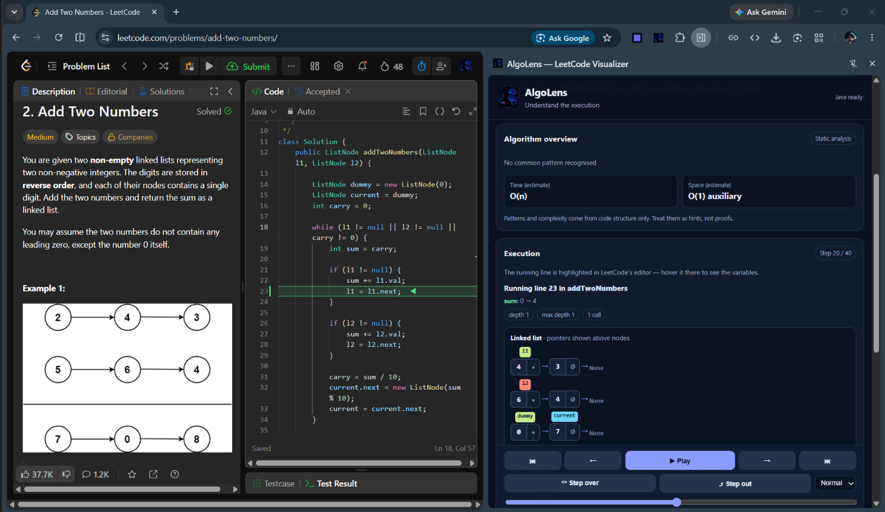

# AlgoLens — Visualize Code. Understand Algorithms.

**Your personal algorithm visualization companion for LeetCode.**

AlgoLens is an open-source Chrome extension that helps developers understand how their code executes through step-by-step tracing, variable inspection, call-stack visualization, and interactive data-structure views — directly alongside LeetCode.

Instead of simply reading an algorithm explanation, follow your own code as it executes.

<p align="center">
  
</p>

<p align="center">
  <a href="https://github.com/Garv3068/AlgoLens/releases"></a>
  <a href="https://github.com/Garv3068/AlgoLens/blob/main/LICENSE"></a>
  <a href="https://github.com/Garv3068/AlgoLens/stargazers"></a>
  <a href="https://github.com/Garv3068/AlgoLens/issues"></a>
</p>

<p align="center">
  <b>Python · Java · C++ · JavaScript</b>
</p>

---

## Demo

See how AlgoLens transforms code execution into a visual learning experience.

<!-- Replace this preview with your actual demo thumbnail or GIF if desired. -->
<p align="center">
  <a href="assets/hero.mp4">
    
  </a>
</p>

<p align="center">
  <i>Select the preview to open the demo video in the repository.</i>
</p>

> **Tip:** GitHub README files do not reliably play repository-hosted MP4 files inline across all views. For a smoother experience, consider uploading your demo to GitHub Releases or a video platform and linking it here.

---

## The Problem

Solving a coding problem is one thing. Understanding every step of its execution is another.

When learning algorithms and data structures, it can be difficult to keep track of:

- How variable values change during execution.
- Why a recursive function is called and when it returns.
- How pointers and indices move through an array.
- How a call stack evolves over time.
- What causes an unexpected result or incorrect output.

Traditional explanations often show the final answer without making the execution process intuitive.

**AlgoLens bridges that gap by making your code's execution visible.**

## Features

### Step-by-Step Code Tracing

Follow your solution one execution step at a time. Inspect the current state, move forward and backward through recorded steps, and understand how the algorithm progresses.

### Live Editor Line Highlighting

Connect execution steps with the corresponding line in your LeetCode editor, helping you see exactly which part of your solution is being executed.

### Variable Inspector

Track variable values as execution progresses. Observe changing indices, intermediate results, function arguments, and other state information.

### Call-Stack Visualization

Explore function calls, nested execution frames, recursion depth, and returned values. Understand how recursive algorithms break problems into smaller subproblems.

### Data-Structure Visualizations

Inspect the structures and values your algorithm works with, including:

- Arrays and strings
- Variables and pointers
- Function frames and call stacks
- Recursion and function-call relationships
- Other supported structures exposed by the tracing engine

The available visualizations depend on the language engine and the structures detected in the trace.

### Four-Language Support

AlgoLens provides separate tracing engines for:

| Language | Execution approach |
|---|---|
| Python | Pyodide/WebAssembly with a Python tracing engine |
| Java | JavaScript-based interpreter |
| C++ | JavaScript-based interpreter |
| JavaScript | JavaScript-based interpreter with Acorn-based parsing |

**Important:** Java and C++ tracing use interpreter implementations, not full native compilers. Some language constructs, standard-library features, and LeetCode solutions may not be supported. Compatibility depends on the implemented language subset.

### Local-First Architecture

AlgoLens is designed to perform its core tracing in the browser, using local workers and bundled runtimes rather than requiring a paid remote execution backend.

This helps keep the project accessible to students and independent developers.

---

## How It Works

```text
        LeetCode Problem
               |
               v
    Read problem and editor code
               |
               v
       Select language engine
               |
       +-------+-------+-------+
       |       |       |       |
       v       v       v       v
    Python   Java     C++  JavaScript
    Pyodide  Interpreter Interpreter Interpreter
       |       |       |       |
       +-------+-------+-------+
               |
               v
       Generate execution trace
               |
               v
       Build shared trace model
               |
       +-------+--------+--------+
       |       |        |        |
       v       v        v        v
     Code   Variables  Call    Data
   highlight inspector  stack structures
               |
               v
      Interactive step playback
```

The tracing engines feed execution information into a shared visualization model. This lets the interface present execution state consistently across supported languages while keeping the language-specific logic separate.

---

## Installation

### Option 1: Install from a GitHub Release

Once a release ZIP is published:

1. Visit [AlgoLens Releases](https://github.com/Garv3068/AlgoLens/releases).
2. Download the latest extension ZIP.
3. Extract it into a folder on your computer.
4. Open Google Chrome and navigate to `chrome://extensions`.
5. Enable **Developer mode**.
6. Click **Load unpacked**.
7. Select the extracted folder containing `manifest.json`.
8. Open a LeetCode problem and launch AlgoLens from the Chrome toolbar.

Keep the extracted folder in place while using the extension. Do not delete or move it after loading the extension.

### Option 2: Run from Source

```bash
git clone https://github.com/Garv3068/AlgoLens.git
cd AlgoLens
```

Then:

1. Open `chrome://extensions` in Chrome.
2. Enable **Developer mode**.
3. Select **Load unpacked**.
4. Choose the cloned `AlgoLens` directory.
5. Navigate to a LeetCode problem and open the extension.

The repository should contain all required runtime files. Preserve the bundled `pyodide/` directory and the language-engine directories when copying or packaging the extension.

> **Note:** Loading an unpacked extension is intended for development and testing. A regular consumer installation through the Chrome Web Store may be added as a future distribution option.

---

## Project Structure

```text
AlgoLens/
├── manifest.json          # Chrome extension configuration
├── service-worker.js      # Extension background coordination
├── sidepanel.html         # Side panel interface
├── sidepanel.css          # Interface styling
├── sidepanel.js           # UI state and engine orchestration
├── content.js             # LeetCode page integration
├── page-bridge.js         # Page/editor communication
│
├── worker.js              # Python worker using Pyodide
├── tracer.py              # Python execution tracing
├── pyodide/               # Bundled Python runtime
│
├── java-worker.js         # Java tracing worker
├── java/                  # Java interpreter
│
├── cpp-worker.js          # C++ tracing worker
├── cpp/                   # C++ interpreter
│
├── js-worker.js           # JavaScript tracing worker
├── js/                    # JavaScript interpreter
│
├── model.js               # Shared execution and frame model
├── render.js              # Shared rendering utilities
├── scene.js               # Execution scene and variable inspector
├── structs.js             # Data-structure and call-tree views
├── inputs.js              # Input and example parsing
│
├── assets/                # Screenshots and demo media
├── README.md
└── LICENSE
```

*This overview describes the principal files; additional runtime and support files may exist in the repository.*

---

## Designed for Learning

AlgoLens is useful for:

- **Students** learning data structures and algorithms.
- **LeetCode learners** debugging and understanding their own solutions.
- **Interview candidates** studying recursion, pointers, loops, and function calls.
- **Educators and mentors** demonstrating how algorithms execute.
- **Open-source contributors** interested in code tracing, developer tools, and visualization.

---

## Privacy and Security

AlgoLens is designed around local-first execution.

- Core tracing is intended to run locally in the browser.
- The extension does not require a paid code-execution API for its core workflow.
- Code should be executed in the designated tracing workers, not in the privileged extension page.
- Do not run solutions containing secrets, credentials, or other sensitive information.

Please review the source code and permissions before installation. Any future remote services, telemetry, or AI integrations should be clearly disclosed.

*Privacy claims should be verified against the exact release build and its network behavior before publication.*

---

## Roadmap

The roadmap focuses on reliability, accessibility, and a better learning experience.

- [ ] Improve tracing accuracy across all four supported languages.
- [ ] Strengthen variable tracking, call-stack reconstruction, and return handling.
- [ ] Ensure backward stepping restores a consistent execution state.
- [ ] Expand support for arrays, stacks, recursion trees, pointers, and graphs.
- [ ] Improve error messages and handling of unsupported language constructs.
- [ ] Add automated tests for tracing engines and shared visualization logic.
- [ ] Improve performance for larger inputs and deeper recursion.
- [ ] Add more screenshots and language-specific demonstrations.
- [ ] Publish reproducible release packages and changelogs.
- [ ] Prepare for Chrome Web Store distribution.

Have an idea that would make learning algorithms easier? Contributions and feature suggestions are welcome.

---

## Contributing

Contributions are welcome! Whether you want to fix a bug, improve a visualization, add test coverage, or extend a language engine, your help can make AlgoLens better for everyone.

1. Fork the repository.
2. Create a feature branch.
3. Make your changes and test them.
4. Commit your changes with a descriptive message.
5. Open a pull request explaining the improvement.

```bash
git checkout -b feature/your-feature
git add .
git commit -m "feat: describe your improvement"
git push origin feature/your-feature
```

Please include reproduction steps for bug reports and a small example when proposing changes to tracing behavior.

- **Report bugs:** [GitHub Issues](https://github.com/Garv3068/AlgoLens/issues)
- **Browse the code:** [AlgoLens Repository](https://github.com/Garv3068/AlgoLens)

---

## Known Limitations

AlgoLens is an evolving developer tool. Keep these points in mind:

- Interpreter-based tracing does not guarantee compatibility with every valid Java or C++ program.
- Complex language features and some standard-library operations may be unsupported.
- Large inputs, infinite loops, and deep recursion can exceed execution limits.
- LeetCode may change its editor or page structure, affecting code extraction or line highlighting.
- Trace quality depends on the accuracy of each language engine and its supported constructs.

If a solution fails to trace, please open an issue with a minimal reproducible example. Remove any personal or sensitive data before sharing code.

---

## Technology Stack

- **Chrome Extensions — Manifest V3**
- **JavaScript, HTML, and CSS**
- **Web Workers**
- **Pyodide and WebAssembly**
- **Acorn-based JavaScript parsing**
- **Custom Java and C++ interpreter implementations**
- **Git and GitHub**

---

## License

AlgoLens is intended to be an open-source project. See [`LICENSE`](LICENSE) for the terms governing use, modification, and distribution.

If the repository does not yet contain a license file, add your chosen license before describing the project as permissively licensed.

---

## Support the Project

If AlgoLens helps you understand algorithms, consider supporting its development:

- ⭐ Star the repository.
- 🐛 Report bugs and suggest improvements.
- 💡 Share ideas for new visualizations.
- 🔧 Contribute code, tests, and documentation.
- 📣 Share AlgoLens with fellow students and developers.

Every contribution helps make algorithm learning more visual and accessible.

<p align="center">
  <b>Understand the execution. Visualize the logic. Master the algorithm.</b>
</p>

<p align="center">
  Made for learners, by learners.
</p>
